# 架构与数据语义

## 模块与数据流

一个 Python 服务提供同源静态页面和 JSON API，使用 SQLite 保存任务/证据/审核，不增加消息队列或第二套 RAG 平台。单个持久化工作线程领取任务，支持重启后恢复中断提取。部署仅支持一个服务进程；多进程任务租约、集中身份系统和分布式队列留到生产化阶段。

OCR 扩展沿用该单服务架构。`documents.py` 同时为本地 OCR 和浏览器原件阅读提供 PDFium 页面渲染；`ocr.py` 使用 RapidOCR/ONNX CPU，识别出的文本进入现有条款切分与模型抽取。行框/置信度保存在已有版本 JSON 字段，不修改图 Schema；PDFium 调用使用全局锁，OCR 模型使用独立推理锁。原件按单页鉴权返回 PNG，前端 `SourceViewer` 负责浏览与证据框显示。

```mermaid
flowchart LR
    A[文件或文本] --> B[上传校验与指纹去重]
    B --> C[(原文件与 SQLite 任务)]
    C --> D[解析与条款切分]
    D --> E[KAG 或 OpenAI-compatible 模型客户端]
    E --> F[Schema 与逐字证据校验]
    F --> G[草稿与人工修正]
    G --> H[审核通过]
    H --> I[OpenSPG writerGraph]
    I --> J[(真实 Neo4j 图谱)]
    J --> K[节点及边回读核验]
    K --> L[发布白名单]
    J --> M[固定参数化查询]
    L --> M
    M --> N[图谱视图与带原文的客服答案]
```

`parsing.py` 处理解析位置，`schema.py` 处理领域定义和校验，`extraction.py` 处理模型调用，`store.py` 处理事务/版本/审计，`workflow.py` 处理状态流转，`graph.py` 是外部图接口边界，`query.py` 组织可追溯事实，`qa.py` 在发布范围内检索原文并校验模型回答。依赖在 app 工厂注入，测试替身不会出现在正式配置选项中。

## 来源与图模型

- 原文件使用随机文档 ID 命名；用户文件名只作为元数据，不参与路径拼接。SHA-256 与导入元数据共同构成去重指纹，同内容不同地区分别处理。
- `documents` 保存上传信息和原始元数据；`revisions` 保存解析、提取、知识状态、模型/时间与乐观锁版本；`audit` 保存变更事件及提取/修正快照。
- Chunk 保留页码、条款路径、前后块 ID 和规范文本内的字符偏移。字符偏移不等于 PDF 字节偏移；新版解析另存原生 PDF/OCR 区域坐标和 DOCX 单元格范围，DOCX 不虚构页码。
- 每个实体/关系保存 `evidence[]`：chunk ID、原文引文、块内起止偏移。校验必须逐字一致；实体名、别名和属性值必须出现在对应证据中。此校验只能证明文本出处，不能证明语义蕴含或材料清单完整，因此仍需审核。
- 模型优先引用服务端提供的 `span_id`，由 `extraction_evidence.py` 绑定真实原文和精确偏移。兼容旧式引文；只对唯一可定位、非空白字符完全一致的引文/字段恢复原文空格换行并记录日志，不做模糊匹配、标点替换或 OCR 纠错。最终仍执行同一严格 Schema/逐字证据校验。结构/Schema 校验失败默认允许一次反馈重试；仍失败则隔离整个块，不丢弃单项错误事实来伪造完整结果。
- 原生有边框 PDF 表格使用 `pdf_tables.py`（pdfplumber 0.11.4，与 KAG 的 pdfminer.six 20231228 兼容），保存单元格文字、行列/合并跨度、归一化页面框及页内偏移。外围正文保留；没有表格或不能安全定位的页面回退原文字层。扫描表格仍由 OCR 生成文本和行框，尚无可靠表格结构或公式校正。
- PDF/DOCX/TXT/图片的抽取每完成一个块即原子保存检查点和已验证的聚合结果，复用现有 SQLite JSON 字段，无数据库结构迁移。重试按输入指纹复用成功块；进程重启继续未完成部分。CSV 目录仍走独立逐行映射校验，不使用该恢复接口。
- 图中的 10 类领域节点使用 `Hotline.<EntityType>` 标签；另有 `SourceDocument`、`Chunk`。`hasChunk` 与 `supportedBy` 连接来源，业务边保存事实 ID、证据、版本 ID、关系类型与内容哈希。
- 节点 ID 包含文档版本范围，历史事实不被新文档覆盖。跨文档提供同地区同类型候选及可撤销审核关联，独立身份账本不覆盖图事实；`canonicalKey` 不等于已经合并实体。同名不同地区不会被合并。
- 条件及材料备选树保存为对应节点的 `rule` 文本属性（JSON），保留 AND/OR/NOT；不编译为资格裁定规则。普通费用/时限等字段留在属性中。
- Schema JSON 是唯一手工维护的领域定义，SPG DSL 和提示词从中生成。生成的 `data/Hotline.schema` 不应手工编辑后反向覆盖配置。
- OpenSPG 0.8 的 Neo4jSinkWriter 将字符串属性做 JSON 编码。适配层集中处理物理编码，API 返回解码的业务属性；查询参数始终绑定，不拼接用户输入。实际图写入校验以此格式为准。

## 一致性与审核

知识状态：`DRAFT → APPROVED → PUBLISHING → PUBLISHED → RETIRED`；草稿/已审核可拒绝，修正后回到 DRAFT。任务状态独立为 QUEUED/RUNNING/READY/PARTIAL/FAILED。PARTIAL 只供检查成功部分及失败原文，不能审核发布。READY 只代表本轮各块通过自动校验，不能证明语义正确或事实召回完整。

发布时先原子记录 PUBLISHING，调用 OpenSPG，再通过相同 Neo4j 回读节点与边的 ID/内容哈希，成功后才加入 SQLite PUBLISHED 白名单。外部写入和 SQLite 不支持跨库原子事务，所以采用保守可重试流程：部分写入不向客服开放；重启后中断发布恢复 APPROVED；相同版本确定性 ID 支持重试，不执行清库。已尝试发布的版本不允许原地修改，需创建新版本，避免部分写入残留与编辑混合。

停用从查询白名单立即移除，历史图仍保留。管理图视图可能看到未成功发布的部分数据，客服图/问答始终只允许 PUBLISHED。知识状态以 SQLite 为权威，不能绕过本服务直接使用数据库中的节点推断已发布。备份需同时保存原文件、SQLite 与 Neo4j，不能只备份其中之一。

## 查询与正确性

`/api/query` 支持保守的领域意图识别，按事项名称/已审核别名召回，图关系查询后绑定原文。找不到事项、范围不唯一、地区未知、结果超限或证据不一致时不输出肯定政策结论。

`/api/qa` 复用上述图查询、模型客户端和来源库，增加“图事实 + 原文关键词/可选向量召回 + 相邻条款 → 模型解释 → 引文/数字/结构校验”。先按 PUBLISHED、地区、事项及明示有效期约束来源，再做关键词排序；最多扫描 200 份文档、5000 个块，保留全部图事实命中块，并选取融合排序前 8 块及相邻块，默认上下文上限 30000 字符。超限要求缩小范围，不能静默截断后假称材料完整。本地嵌入语义召回已通过适配器接入，使用配置及内容散列缓存向量；大规模全文索引留待后续。

已检查 KAG 的 `TextChunkRetriever`、`VectorChunkRetriever`：它们依赖 OpenSPG 搜索索引，当前没有本应用的发布版本白名单语义。本次沿用已验证的图接口和原文存储，新增受发布范围约束的关键词和可选嵌入召回适配，没有复制完整 KAG solver 或将未审核数据送入通用检索。应在发布过滤及索引生命周期适配完成后再接入上游通用检索器。

每段模型解释带可定位的连续原文，引文不存在、数字无依据或非法 JSON 则最多重试一次，仍失败保留结构化结果。核实项采用枚举，避免在附加说明里生成未经引用的事实。模型调用后再次检查来源是否仍发布；审计只记录模型名、来源版本及状态，不记录完整问题、提示词或密钥。

多条款来源聚合时保留全部已检索材料及条件树，多个发布来源的要求集不同则提示冲突。查询期间知识被停用时返回 409 要求重试。明确未来施行或已失效文件不用于当前办理答案；没有失效信息不等于现行有效，时效统一保守标为待核实。`as_of` 约束业务时间，上传/提取/审核时间另存 UTC；默认查询日期按 Asia/Shanghai。

答案先展示问题所问字段，再展示完整条件。只有在同一版本、相同证据下，一个无规则子条件的原文字面已包含于完整条件时，才合并重复展示；不同证据、不同版本或额外条件继续保留，数据库断言不被删除。

## 图谱交互与溯源

`static/graph-view.js` 独立管理 SVG 视图：滚轮或按钮缩放（20%–500%）、画布平移、节点拖动、适应画布和全屏。键盘 `+`、`-`、`0` 分别缩放与适应；拖动更新连线和文字位置，不修改图数据库；重新检索后重新布局。默认隐藏密集关系文字，悬停边显示类型，点击边查看完整关系和证据。

节点、关系及 QA 引用均可打开原文弹窗；按已存偏移高亮引文，显示版本、页码/章节、来源网址、前后段，支持查看解析全文及下载导入源文件。下载与全文接口沿用来源权限，没有把令牌拼入 URL。若输入是从网页或 PDF 提取的 TXT，页码为空，下载的是该 TXT，不冒充官网 PDF 原件。

## 原则与取舍

KISS/YAGNI：单服务、轻量页面、有限意图、确定性答案，先实现可审查的数据流。DRY：集中 Schema 和证据校验，领域类型不散落在提示词中。单一职责：解析、抽取、审核、存储、查询分层。依赖边界：外部模型/图适配器独立，测试使用显式注入，不在业务运行时切换假服务。

## 对话与图探索前端

`chat-view.js` 管理当前页面的对话记录、显式范围与每轮来源；每轮仍请求现有无会话 API，不传递旧答案作为证据。`graph-explorer.js` 管理真实查询结果的布局与选择，复用 `graph-view.js` 的缩放/拖动及 `source-viewer.js` 的原件阅读。样式扩展位于 `explore-chat.css`，颜色令牌仍集中在 `style.css`。本地 D3 布局不修改数据库，无新增后端或数据迁移。

自然语言事项召回由 `retrieval.py` 编排：已发布来源元数据只参与地区/标题筛选，候选和事实仍读取真实图数据库。精确检索失败时进行有上限的词面候选召回；相近名称及上下级地区需确认，不能据此生成适用于全省的答案。`qa.py` 的原文过滤复用已解析范围，避免图检索和原文召回采用不同地区。

## 语义与证据升级

Schema JSON v2 保持原有 SPG 类型/关系，扩展的是 JSON 属性语义。原文 name 保留，canonical_name 由有限字形/断词规则计算；展示名称必须有原文依据。语义质检提示需逐项核对，新版提取的审核通过必须提交确认项。明确主体类别、简单二选一材料及明示线性流程可作可追溯规范化，复杂条件不强行推断。详见 [升级说明](archive/semantic-upgrade.md)。
